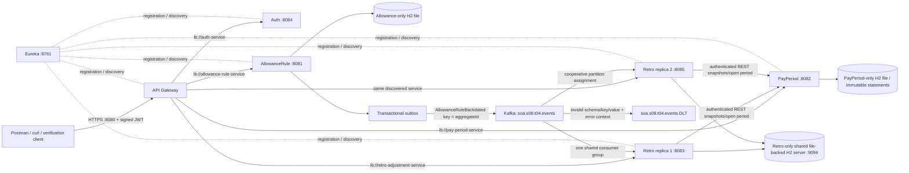

# Payroll-retro service diagram

Eureka also registers itself: six application names, seven instances with two Retro replicas. The two replicas share only their own domain database. No cross-database queries or shared JPA entities exist. Rules publish independently; Retro reacts, persists receipt/workflow state and retrieves historical snapshots through REST. Approval is distinct from calculation and never rewrites an issued statement.

The default single-instance Retro profile embeds its H2 file. The optional local cluster profile uses an independently running loopback H2 server over the same Retro-owned file, so stopping one application does not stop storage. This is application failover, not database high availability.

The verification module uses the same packaged apps and HTTPS with isolated random ports, generated test keys and fresh data directories. Its real embedded KRaft broker removes the need for a Docker daemon in CI; no controllers or database repositories are mocked in that system test.
